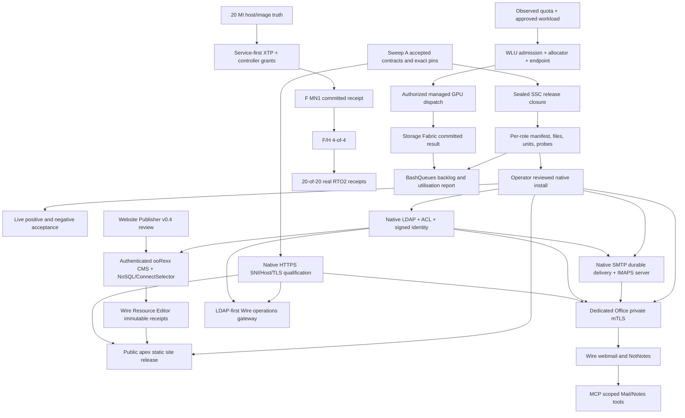

# SERVICE_ACTIVATION_DAG.md — ALCH-SWEEP-B

**Audit date:** 2026-10-27 UTC  
**Role:** ALCH-SWEEP-B, consumer/install integration audit (read-only)  
**Repository:** [https://github.com/animatedads/alchemy](https://github.com/animatedads/alchemy), default branch `main` as inspected; Git tree `0998d081f0efff18231f929cc4d4714ea7243de8`  
**Additional evidence:** GitHub issues [#6–#14](https://github.com/animatedads/alchemy/issues/6) individually, [#17](https://github.com/animatedads/alchemy/issues/17), [#47](https://github.com/animatedads/alchemy/issues/47), [#62](https://github.com/animatedads/alchemy/issues/62); draft [PR #63](https://github.com/animatedads/alchemy/pull/63); authenticated Rasen Falcon lane metadata and selected mailboxes.  
**Release boundary:** no production install, network mutation, credentials, keys, or DNS edits. No live remote host tests were run. Main and draft/branch source are distinguished.  
**Sweep A dependency boundary:** Sweep A's accepted producer contract ledger was **not available to this audit**. Every producer pin/API listed here is a consumer demand, not a new accepted version or provider authority. Reconcile against Sweep A before invoking installer.

## Executive disposition

**SOURCE EXISTS ≠ QUALIFIED ≠ INSTALLED ≠ OPERATIONAL.** Tom has confirmed the public website, native LDAP, SMTP/IMAP and related services are not installed; GitHub agrees that the relevant releases are source-only or candidates. The most immediate integration blocker is an absent installable **per-role release**: the v0.3 deploy controller demands `roles/$RF_ROLE/files`, `manifest.tsv`, `services.txt`, `tests.tsv` and executable real probes. The [Rasen Falcon v0.4 tree](https://github.com/animatedads/alchemy/blob/main/packages/rasenfalcon_delivery_v0.4/README.md) contains no assembled release-role directory and no Rasen Falcon `.service`/`.timer` files. An inventory of the full Git tree found just unrelated systemd service examples (cloud-economics and SSH-over-XTP) and **no `rasenfalcon-*.service` or `.timer`**. This is not a claim about remote hosts; it is a checked Git-tree absence. The handoff states explicitly that deployment is a skeleton and not commissioned.

The [deployment controller](https://github.com/animatedads/alchemy/blob/main/packages/rasenfalcon_delivery_v0.4/handoff/deployment/deploy.sh) already has digest/path validation, role-scoped service/test inventories and preflight/verify/rollback commands. It must be **completed with actual artefacts**, not replaced. A specific contract defect requires reconciliation: the controller's `required_units()` names generic `rasenfalcon-https.service`, while [HOSTS.json](https://github.com/animatedads/alchemy/blob/main/packages/rasenfalcon_delivery_v0.4/handoff/deployment/HOSTS.json) and the [private HTTPS policy](https://github.com/animatedads/alchemy/blob/main/packages/rasenfalcon_delivery_v0.4/handoff/contracts/PRIVATE_HTTPS_POLICY.json) explicitly name distinct `rasenfalcon-noc-https.service` and `rasenfalcon-office-https.service`. Also the install destination allowlist accepts `rasenfalcon-*.service` but **does not accept `.timer`** files; this matters because BashQueues cron is woken by a systemd minute timer. These are code/manifest seams, not a justification to weaken private mTLS or use system crond.

## Evidence classification and limits

| Code | Meaning |
|---|---|
| `ABSENT_IN_INSPECTED_MAIN` | Filename or required release payload absent in inspected Git main tree; may exist in Library, branch, or on an uninspected host |
| `BUILD_MISSING` | Source explicitly excludes required operation or only supplies a partial command core |
| `LOCAL_TEST_CLAIM` | Repository records local tests; this audit did not independently rerun them |
| `REVIEW_ONLY` | Draft PR / Autobuild submission, not accepted main release |
| `NOT_INSTALLED` | Confirmed by Tom for specified Rasen Falcon services; no live host inspection conducted here |
| `NOT_RUN` / `NOT_OBSERVED` | No qualified live evidence obtained; NOT a negative assertion about an uninspected host |
| `POLICY_ONLY` | Written security architecture without proof of configured live process |

The uploaded ooRexx Debian package was inspected read-only with `dpkg-deb -f`: package `oorexx`, version `5.3.0`, architecture `amd64`. The filename says r13196, but package metadata alone does not prove the active host ABI, runtime fingerprint, or deployment acceptance. The container could not resolve github.com via direct Git; therefore this audit used the authenticated GitHub connector to fetch the repository tree and source files. No component suites or live tests were run by this auditor.

## Consumer activation DAG

The following arrows are **requirements**, not claims that any stage is live:

### Service-by-service blocker diagnosis

**1. Public site / Website Publisher / CMS / Wire.** The [nine-page website](https://github.com/animatedads/alchemy/blob/main/examples/rasenfalcon_website_suite_v0.1.0/README.md) is editable and the ooRexx [preview adapter](https://github.com/animatedads/alchemy/blob/main/examples/rasenfalcon_website_suite_v0.1.0/website/server/serve.rex) is loopback-only, not a public HTTPS vhost. The [public-site integration handoff](https://github.com/animatedads/alchemy/blob/main/packages/rasenfalcon_delivery_v0.4/handoff/public_site/INTEGRATION.md) records 9/9 local site tests, and deliberately refuses production build without per-page approval. [Publisher v0.3](https://github.com/animatedads/alchemy/blob/main/packages/alchemy_website_publisher_v0.3/README.md) persists NoSQLServer v0.90 editorial revisions through a *file-to-native-CLI handoff*; it is **not a live CMS**. The newer [v0.4 draft PR #63](https://github.com/animatedads/alchemy/pull/63) claims 46 browser, 36 native/source and 36 actual Rasen Falcon staging/preview checks, with no production CMS/Wire/ConnectSelector or deployment acceptance. [Issue #62](https://github.com/animatedads/alchemy/issues/62) correctly demands authenticated single-writer editorial service, independent identity/review/revocation, true SHA-512 Wire Resource Editor release receipts, explicit activation authority and RexxOS confinement. `site/cms-export.json` and content SHA-256 are candidate artifacts, **not** signing or Wire publication authority. Preserve source ownership: Website Builder owns its nine pages; Publisher owns editorial proposals, not site release.

**2. HTTPS and host routing.** [Native HTTPS source](https://github.com/animatedads/alchemy/blob/main/packages/oorexx_https_server/README.md) describes RxSock-owned sockets, OpenSSL memory BIO/Foreign Runtime, bounded admissions, certificates and optional mTLS. That does **not** prove multi-SNI/vhost host dispatch or server-side mandatory mTLS configured. Git main's README concerns v0.4.6; Website Builder pins exact v0.4.7 ZIP SHA-256 `ae1a4caa1f48d6348cdfa283323a25e300bda5c30b7ea5f8ef825c635502ac3c`, while Rasen lane discussions reference later unqualified v0.4.8 streaming work. Select accepted source via Sweep A, not highest version. [Issue #7](https://github.com/animatedads/alchemy/issues/7) mandates TLS certificate selection + normalized Host/SNI match and fail-closed unknown-host denial. Public apex/www may use public-trusted HTTPS; **NOC and Office are separate native non-root processes**, each with own private-CA server cert/key and compulsory client cert at handshake, before LDAP. [Host map](https://github.com/animatedads/alchemy/blob/main/packages/rasenfalcon_delivery_v0.4/handoff/deployment/HOSTS.json) only establishes NOC CNAME `noc.rasenfalcon.com` → `london1.rasenfalcon.com`, `london1` A `213.255.246.44`; gateway/office/mcp A/AAAA, ports, TLS artefacts and actual OS are unknown in manifest, not to be invented. MCP DNS is operator-controlled. No Nginx/Apache substitute, default host fallback, ACME/public CA for private services, or HTTP bypass.

**3. LDAP/signing/permissions/revocation.** [LdapWireServer.cls](https://github.com/animatedads/alchemy/blob/main/packages/oorexx_ldap_identity/src/LdapWireServer.cls) is real native LDAPv3 TCP conversation source with `ldap.wire/0.1`, optional TLS/LDAPS, bind/search and controls. It is not merely a policy sketch. It defaults to development localhost:1389 and is exercised by fixture servers; no reviewed live directory daemon unit, production identity/secret references or real restart/revocation evidence was observed. [Issue #8](https://github.com/animatedads/alchemy/issues/8) requires signed/key lifecycle and Access Permissions for every consumer, distinct human/ChatGPT/Claude authorities and immediate or bounded revocation. The Rasen lane `ldap-identity` is actively claimed by CHATGPT and a dev20 candidate [PR #61](https://github.com/animatedads/alchemy/pull/61) has independent **NOT_RUN** review; do not reopen or fork its identity authorities. Issue signed mail grants only through owning policy; DKIM is not user-message signing.

**4. SMTP/IMAP/durable delivery.** [SMTP source](https://github.com/animatedads/alchemy/blob/main/packages/oorexx_smtp_secure_stack/README.md) implements signed relay policy, durable Storage Fabric message projection, outbound spool, retries and STARTTLS; [SmtpWireServer.cls](https://github.com/animatedads/alchemy/blob/main/packages/oorexx_smtp_secure_stack/src/SmtpWireServer.cls) is a real bounded RxSock listener, but defaults to localhost:2525 and lacks a production daemon manifest and qualified gateway listener set. Outbound relay must satisfy verified user-bound message signature, exact authenticated sender match, EMAIL_SEND, deterministic policy and any configured mandatory advisory; unsigned inbound is retained under `INBOX-UNSIGNED`. The [IMAP package](https://github.com/animatedads/alchemy/blob/main/packages/oorexx_imap/README.md) records extensive **client** TLS/mailbox tests, whereas [ImapServer.cls](https://github.com/animatedads/alchemy/blob/main/packages/oorexx_imap/src/ImapServer.cls) explicitly identifies itself as partial **dev10** metadata/session server core, not IMAP4rev1. The package root README still identifies dev8 client line: consumer release pin and server acceptance need splitting. [Issue #9](https://github.com/animatedads/alchemy/issues/9) requires live IMAPS 993 TLS listener and APPEND/FETCH/UID FETCH/STORE/SEARCH/COPY/MOVE/EXPUNGE, mailbox UIDVALIDITY/UID durability, SMTP port 25 and authenticated submission 587, restart and negative cases. Mail DNS (MX/PTR/SPF/DKIM/DMARC) remains an operator readiness gate.

**5. Wire Office, NotNotes, MCP and operations gateway.** [Issues #10](https://github.com/animatedads/alchemy/issues/10), [#11](https://github.com/animatedads/alchemy/issues/11) and [#12](https://github.com/animatedads/alchemy/issues/12) describe **consumers** that cannot be green until HTTPS device mTLS, LDAP/ACL, Mail/NotNotes persistence and application adapters are proven. Office routes are `/mail` and `/notes` on a dedicated private native instance. [Wire application deployment candidate 2](https://github.com/animatedads/alchemy/blob/main/packages/wire_application_deployment_v0.1_candidate2/README.md) has local native contract tests but no qualified public network WebSocket/TLS deployment, signed `.wapp` verifier, or restart recovery. [MCP Service](https://github.com/animatedads/alchemy/blob/main/packages/oorexx_mcp_service_v0.2-dev8/README.md) supplies an ooRexx JSON-RPC protocol adapter and project coordination tools, not evidence that isolated **Mail/NotNotes** tools are deployed on `mcp.rasenfalcon.com`; do not mistake a working Rasen Falcon agent mailbox application for target-service acceptance. Gateway's only approved terminal targets are `ed209zz`, `ed209z`; only web targets are `ed209cray`, `ed209tops`. No general proxy or target-before-LDAP authorization.

**6. ED209 MUs/MIs/RTO2.** [Issue #17](https://github.com/animatedads/alchemy/issues/17) separates the commissioned target of 10 MUs/20 MIs from the old generic 8-MU/16-MI reference. [Candidate2 qualification](https://github.com/animatedads/alchemy/blob/main/packages/ed209_rto2_20mi_candidate2/qualification/STATUS.md) claims local native authenticated one-MI job and synthetic 20-receipt sort, explicitly **not 20 live MIs**. The [candidate2 status](https://github.com/animatedads/alchemy/blob/main/packages/ed209_rto2_20mi_candidate2/qualification/CANDIDATE2_STATUS.md) says F/H 4/4 and full 20/20 NOT TESTED. Source branches for candidate3/sphere v0.3 were ready for Autobuild, but Rasen request reports no accepted output receipts on inspected main at verification. Exact current guest images, real QFXTP response vs service-first XTP FIRST/KEY/DATA, grant manifest `grid-controller`, signing and route/carrier checks must be reconciled before 1→4→20 genuine receipts. **This audit did not SSH to fleet or claim all MIs off**. `sshnode.sh` is operator control to MUs; MI dispatch remains authenticated Queue Fabric over XTP, not SSH to guests.

**7. Managed GPU and scheduling.** [Issue #47](https://github.com/animatedads/alchemy/issues/47) is a programme tracking item, not authorisation to consume paid quota. [HF Space Job](https://github.com/animatedads/alchemy/blob/main/packages/oorexx_huggingface_space_job_v0.3-dev1/README.md) enforces quota budget/allocator gates and has local fixture qualifications; its nominal 2,400s is **not actual entitlement or reset proof**. The [managed endpoint](https://github.com/animatedads/alchemy/blob/main/packages/huggingface_space_managed_endpoint_v0.2-dev1/README.md) exposes allowlisted `/job_cpu`, `/job_large`, `/job_xlarge` and explicitly reports `OPERATION_IMPLEMENTATION_MISSING` for absent fixed training script; no arbitrary shell. [Colab job](https://github.com/animatedads/alchemy/blob/main/packages/oorexx_colab_job_v0.3-dev1/README.md) is separate, uses fake command executor for local tests, and does not confer durable Storage Fabric commit authority. Exact quota, reset, 7-day usage, actual installed worker and task backlog are **NOT_OBSERVED**. Need observed quota, worthwhile bounded work, WLU/allocator hard admission, approved ZeroGPU call, SHA/size + durable commit, and BashQueues recurrence and utilisation receipts; no silent paid spillover, vanity burn or duplicate retry after uncertain calls.

## Five shortest evidence-backed paths to useful operational services

“Shortest” means **fewest presently missing integration gates** with existing source reused, not estimated elapsed time. Each path stops at a narrow operational deliverable instead of asserting completion of all downstream consumers. Host and human approvals remain mandatory.

| Rank | Minimal target | Source already present | Blocking sequence (in dependency order) | Acceptance stop point |
|---:|---|---|---|---|
| 1 | **Public nine-page read-only site** (not CMS) | builder/preview and native HTTPS adapter | pin HTTPS/SNI → approve each page/brand/privacy → assemble read-only public role release/units → operator TLS/DNS/cutover | 9 routes and assets on correct public cert; no admin routes; live restart/rollback and negative Host cases |
| 2 | **LDAP directory bind/search** | `LdapWireServer.cls` with tests | pin accepted LDAP dependency closure → create least-privilege service startup/persisted identity + TLS/secret refs → operator install → real bind/search/revoke/restart | External LDAP client success and denied invalid/revoked credentials; no key leakage |
| 3 | **NOC protected HTTPS health/landing** (not complete NOC apps) | HTTPS runtime + policy | qualify private mTLS/SNI → issue separate NOC private-CA leaf and device cert on approval → dedicated nonroot unit → owner test via NOC hostname | TLS rejects missing/wrong/revoked client cert before route; CNAME+SNI/Host correct |
| 4 | **Inbound SMTP to durable `INBOX-UNSIGNED`** (not full mail suite) | `SmtpWireServer`, durable delivery provider | pin Storage Fabric/mail source → bind real gateway listener and spool → reviewed role/unit & recipient policy → operator mail DNS/firewall → crash and injection test | Genuine port 25 delivery and restart-preserved bytes, no relay, bad RCPT denied |
| 5 | **Approved managed GPU pilot** (one valuable bounded job) | HF Job + managed Space endpoint + allocator adapter | observe entitlement/reset and actual endpoint → prepare allowlisted workload; CPU-only real preflight → WLU/allocator admit + explicit GPU execution authority → run exactly one GPU job → Storage Fabric commit | Provider GPU-seconds observed, valid SHA/size durable artifact, reconciled usage/cleanup; never assume 40 minutes remain |

**Longer paths, not safe to conflate with the above:** production CMS/Wire publishing adds institutional approval, authenticated ooRexx service, Resource Editor receipt and RexxOS isolation to path 1. Complete mail adds IMAPS command/server implementation and outbound signing to path 4. Office/MCP and gateway consume both HTTPS and LDAP plus their own app adapters; ED209 20/20 additionally needs actual guest-image upgrade and multi-carrier XTP acceptance.

## Owner and collision ledger (authenticated Rasen Falcon, 27 Oct)

| Lane | Active claim observed | Sweep B disposition |
|---|---|---|
| `rasenfalcon-website` | none | Website source and CX-09 release seam; 3 requests, including pending read-only independent qualification. New chat **coordinate** before any source edits |
| `website_publisher` | none | Active v0.4 draft PR #63, issue #62; read-only test request returned NOT_RUN pending exact permissions. Do not rewrite Publisher |
| `ldap-identity` | **CHATGPT** | Source dev20 review PR #61 and independent NOT_RUN; avoid its implementation entirely |
| `mail` | none | Owns SMTP/IMAP consumer orchestration; suitable isolated qualification or service composition lane only after claim/brief |
| `webdav-https-streaming` | none | HTTPS v0.4.8 and WebDAV dev6 candidate qualification pending NOT_RUN; do not invent another SNI/TLS authority |
| `oorexx_deployment` | **CHATGPT** | dev4 sealed SSC namespace committed on main; independent review pending; do not replace deployment core |
| `wire_application_deployment` | **CHATGPT** | Candidate3 native admission/replay review returned NOT_RUN; avoid modifying app-deployment internals |
| `rto2` | **CHATGPT** | Candidate3 branch and sphere v0.3 submission, owner already active; restrict new chat to read-only image/route evidence |
| `xtp` | **CLAUDE** | Independent producer owner; only consume contracted service-first semantics |
| `notnotes-core` | none | dev17 committed, native qualification pending; Office app integration must not fork document truth |
| `agent-mailbox` | none | MCP project's own lane; Mail/Notes tool integration separate from installed coordinator service |
| `generalized-compute-intentions` | **CHATGPT** | AI Model Router adapter qualification pending; no new WLU/allocator authority |
| `ed209-fleet` / `ed209-rebuild` | none / none | Read-only fleet inventory and rollout prep only, preserve installed keys/images |

### Safe independent new-chat briefs (no owner collision)

1. **RF install-receipt auditor, read-only.** Cross-check `deploy.sh` against `HOSTS.json`, `PRIVATE_HTTPS_POLICY.json`, source tree, CX-09 tests; produce a machine-readable missing release-role/unit/timer/probe inventory and suggested patches for the `rasenfalcon-website` lane owner. Do not edit `oorexx_deployment`, units or real hosts.
2. **Mail service composition qualification, fixture-only.** In `mail` lane, test existing SMTP/IMAP class contracts, enumerate missing dev10 server verbs and exact durable mailbox join, prepare distinct negative-case acceptance scripts **without** modifying `ldap-identity` or its key authority. No Postfix/Dovecot.
3. **CMS boundary contract conformance, independent review.** Read PR #63 and issue #62; write only an acceptance/negative-case matrix for real ConnectSelector + authenticated CMS + Resource Editor receipts, preserving Publisher-owned v0.4 editor and site builder sources. Coordinate before any code.
4. **ED209 fleet image/acceptance reconciliation, read-only.** In `ed209-rebuild` or `ed209-fleet` after coordination, compare candidate3 ready receipts and 20-MI guest/service manifest to issue #17; produce a per-MI gate matrix with unknown live fields. No SSH writes or production keys.
5. **GPU entitlement/workload readiness auditor, read-only.** Coordinator creates/assigns a distinct consumer activation lane; inventory approved non-sensitive backlog, model requirements, current credential-free provider capability/quota proof paths, WLU/allocator and Storage Fabric commit contracts. No metered calls, and no generalized-compute-intentions implementation changes.

A lack of active claim is **not** licence to take an existing project's code: GitHub issues and open PRs are work in progress. Each new chat should search its proper Rasen lane and send a bounded ownership request before modifying it.

## Evidence and execution register

- **GitHub main:** recursive tree inspected at `0998d081f0efff18231f929cc4d4714ea7243de8`; 22,393 blobs; 0 Rasen Falcon unit/timer files and no `roles/ROLE` release payload under `packages/rasenfalcon_delivery_v0.4`.
- **GitHub issues inspected individually:** #6, #7, #8, #9, #10, #11, #12, #13, #14, #17, #47, #62. Comments on #17 and draft PR #63 consulted.
- **Source entrypoints inspected:** public `website/server/serve.rex`, `SmtpWireServer.cls`, `LdapWireServer.cls`, `ImapServer.cls`, release `deploy.sh`, `HOSTS.json`, `PRIVATE_HTTPS_POLICY.json` and relevant READMEs/qualification claims.
- **Rasen Falcon:** authenticated `project_components_list` across 65 lanes; selected request mailboxes inspected, including pending independent tests marked NOT_RUN. Read-only, no claims or edits.
- **Local uploaded Debian artefact:** inspected header only. No `rexx` execution or package install in this audit; no access to production credentials or live service management.
- **Out of scope:** re-inventorying Sweep A producers; authorising live deployment; any DNS, key or firewall mutation; claims about actual ED209/GPU/live server state without host/providerevidence.

## Coordinator decision request

Approve a narrow **consumer integration work partition**, not live cutover: resolve accepted dependency pins through Sweep A; assign CX-09 immutable role release/units/timers/real probes; separate HTTPS host/private mTLS tests; assign authenticated CMS publisher-release seam; finish IMAPS server and mail durable join; put GPU and ED209 live evidence behind explicit operator approval. Do **not** declare an operational service on a fixture PASS, a draft PR, or successful Git commit.

**Attached CSV:** `SERVICE_CRITICAL_PATH.csv` defines **46** individually evidenced, status-coded consumer prerequisite edges with owner/lane suggestions and acceptance proofs.
---

## 28 October 2026 — Sweep A reconciliation and independently witnessed follow-up

### Changed evidence and execution boundary

The original 27 October audit remains a historical snapshot. On 28 October, authenticated Rasen Falcon `programme` request **REQ-00000973** exposed the full Sweep A producer report (same 27 October Git baseline). That report found **no independently verified accepted, recursively resolvable source closure**: `source_get_package` failed for three roots with `SOURCE_PACKAGE_FAILED`, and sphere checks failed with `SPHERE_CHECKER_UNAVAILABLE`. These are *unverified acceptance*, not evidence that source does not exist. Consequently **B001 is still BLOCKED**: `oorexx_deployment` dev4’s deterministic release-local `REXX_PATH` materializer needs a *previously satisfied sealed lock*; it cannot manufacture acceptance from a Git directory name. The correct interface handoff is to obtain an actual QUALIFIED SSC deployment ID, immutable artifact hash and dependency closure from the producer (Sweep A), then materialize/verify that closure in the consumer installer (Sweep B).

**Independent current-Git verification (read-only GitHub connector):** current `main` at `515c8a2b8c09d2bebc4643b893a35f0ad7ddcdfd`, recursive tree **26,661 entries, not truncated**. Comparing against prior `0998d081...` returns **one new commit and one unrelated changed file**; none of the audited Rasen Falcon service deployment files changed. Re-read `packages/oorexx_queue_fabric_v0.9-dev6/integration.json` with `rexx_path.mode=replace` and `require_entries=true`: of its six declared `packages/.../src` directories, *only* `packages/oorexx_crypto_v0.1/src` exists on inspected `main`. The five absent paths are `packages/nosqlserver_v0.77/src`, `packages/runtime_registry_v0.12/src`, `packages/alchemy_objects_v0.5/src`, `packages/oorexx_work_load_units_v0.6/src`, `packages/oorexx_queue_fabric_v0.8.2/src`. Thus the declared Queue Fabric dev6 Autobuild test matrix is **not reproducible from this Git tree alone**, impacting durable mail, Grid dispatch and scheduling consumers that need that specific Queue Fabric revision; it does not prove that every earlier release or Library-delivered closure is unusable. Source: [Queue Fabric dev6 integration.json](https://github.com/animatedads/alchemy/blob/main/packages/oorexx_queue_fabric_v0.9-dev6/integration.json).

The same current-tree inspection found **zero** `rasenfalcon-*.service`, **zero** `rasenfalcon-*.timer`, and **zero** files under `packages/rasenfalcon_delivery_v0.4/release/roles/`. `deploy.sh` still names generic `rasenfalcon-https.service` but does **not** mention either `rasenfalcon-noc-https.service` or `rasenfalcon-office-https.service` required by `HOSTS.json`; no destination allowlist for `rasenfalcon-*.timer` was found and the deployer has no BashQueues wiring. This verifies the original CX-09 source-contract findings; it does not inspect host state. Fixing these requires the existing CX-09 owner to ship *real* per-role service/host identity mappings and probes, not a dummy `rasenfalcon-https.service` or an invented second installer.

**Runtime witness:** the user-supplied Debian package `oorexx-5.3.0-13196.ubuntu1604debug.x86_64(1).deb` has SHA-256 **`8add57fd2463403c9e91f3f49856e3f61b34753938abab3a617fc8063d2df4ae`**, matching Sweep A’s recorded runtime pin and the website source lock. It was unpacked to private scratch storage with `dpkg-deb -x` (no installation), and its extracted `rexx -v` returned `Open Object Rexx Version 5.3.0 r13196 - Internal Test Version`, `Addressing mode: 64` with exit code 0. This proves this specific interpreter artefact is executable here; it does **not** qualify Foreign Runtime, XTP, API compatibility, the target hosts or a complete service release.

### Newly received independent website qualification

Authenticated `rasenfalcon-website` reply **REQ-00001007** (28 Oct) records that Tom approved test-only brief REQ-00000943 by name and that CLAUDE-PC ran its **unaltered pinned branch** `autobuild-submit/20261027T163400Z-CHATGPT-rasen-v042-publisher-stage-b12ce4`, HEAD `0718e920eb91b47d608e1754d288eda20fe9e0ff`, in local scratch. Python 3.13.15. Results:

- `website/tests/test_site.py`: **18/18 PASS** (publisher stage, negative forged-approval and production denial cases included).
- `handoff/tests/test_*.py`: **12/13 PASS; one FAIL**, `test_exact_website_source_lock`.
- `bash -n website/deploy/site_contract_probe.sh` and `bash -n handoff/deployment/deploy.sh`: **PASS** (syntax only).
- `python3 website/tools/site.py validate`: **9 pages, PASS**. Production build: **expected denial** (`authenticated CMS, Brand and Wire release receipts not integrated`).

Independently inspected the exact branch’s `handoff/tests/test_v04_integration.py` and `handoff/public_site/github_source.lock.json`: the test iterates `files_sha256` and SHA-256-checks every listed `website/` file, including `docs/QUALIFICATION.md`. For that file the manifest expects **`064c74dcda17293e39a9e38327e3c10138e3e89dda711c508f379d95660cee9e`**, whereas the unchanged independent run observed **`20825d34f3e6fa0618ac8f2e7a1003b2caf9e39819d08748cc8b5c4b37655d83`**. This is a **real failed integrity test, not a passing handoff**. The immediate engineering task is for the existing website source owner to determine which document/version is authoritative, update/rebuild the **entire** content lock under source governance, rerun the unchanged test and resubmit through Autobuild; merely changing the expected hash to silence the test is not an acceptance decision. The candidate remains an uninstalled preview even after that repair.

These observations supersede the old '18 declared tests, not independently run' note for **that exact candidate branch only**. The prior 27 October mainline 9/9 website claim and Publisher v0.4 draft PR #63 are different source/qualification observations; do **not** combine test counts or treat this result as PR #63 independent acceptance.

### Sweep A → Sweep B blocking handoffs (without duplicate provider inventory)

| Producer finding and authority owner | Consumer operation blocked | Reconciliation/closure evidence required |
|---|---|---|
| SSC sealed package resolver unavailable for tested roots; proposed SSC owner + `oorexx_deployment` | CX-01 source-lock floor and CX-09 installable release; publisher native closure | Successful read-only `getDeploymentPackage`/`source_get_package` for chosen QUALIFIED release plus an immutable dependency receipt, exact ABI and namespace verification |
| Queue Fabric dev6 five missing exact source paths; `queue-fabric` | Signed outbound SMTP spool dispatch, ED209 authenticated job delivery, durable BashQueues/Queue Fabric boundary tests | Correct, accepted Queue Fabric source/manifest and dependency lock with no local Library guessing, then full declared test matrix |
| Socket Provider canonical dev14 vs XTP dev31 requiring dev16; `xtp` + Socket Provider owners | ED209 service-first XTP L2/L3/L4 RTO2; transport-dependent gateway paths | Accepted selector/provider ABI and named-service FIRST/KEY/DATA field receipts, not merely loopback fixture PASS |
| ConnectSelector dev7 Git patch-only, full archive missing; `connect-selector` | Authenticated CMS editorial service and optional MCP/Queue service dispatch | Full accepted ConnectSelector source and API contract recovered; direct JSON-RPC without compulsory Queue Fabric for simple RPC |
| Storage Fabric dev21 unversioned vs dev23 precision candidate; `storage-replica-repair` | Durable mailbox message bytes, Website Publisher release storage, GPU output commit | Selected two-site object permanence/metadata schema and executable read-back/replica receipts under one owner |
| Crypto v0.8.3 qualification with FR v0.22.2 vs FR Git v0.22.6; Crypto/Foreign Runtime owners need lanes | Signed SMTP, private-CA/mTLS and LDAP key lifecycle; native HTTPS | Actual pinned FR/OpenSSL/cryptographic ABI on target, verified issuance/signing/rotation/revocation negative tests |
| WLU/Registry 0.12 vs Queue integration WLU 0.6 and Registry 0.12; WLU/Registry authority | Quota-aware managed GPU execution and RTO2 placement | Approved WLU/Job-to-Node lease and settlement contract against qualified Registry release; no invented GPU quota |
| Autobuild receiver not shown live; `autobuild` | ALL candidates waiting for accepted publication/receipt | Real receiver acceptance record, published source tree and unaltered test outputs; submitted branch alone is not success |

### Recommended next *non-overlapping* action

1. **P0 release admissibility owner:** CX-09 (`rasenfalcon-website` coordination with `oorexx_deployment`) should build an **offline-only role manifest/unit/probe validator** accepting Sweep A's sealed pins, rejecting absent role payloads, wrong NOC/Office unit names, timer omissions, fallback TLS and missing real tests. This can be developed and tested without touching production, but should be assigned through the Coordinator, not claimed by the audit chat.
2. **P0 source integrity owner:** existing Rasen Falcon website candidate author should investigate the `docs/QUALIFICATION.md` source-lock mismatch from REQ-00001007; require a fresh full unchanged independent handoff test. No public site approval implied.
3. **P0 producer handoff:** Coordinator should use Sweep A's `CORE_DEPENDENCY_LEDGER.md` and 45-edge CSV to assign accepted pin/complete closure checks before CX-09 makes any immutable release. No competing provider-inventory implementation.
4. **Qualification brief discipline:** CLAUDE-PC should receive exact commands, cwd, SHA, environment, authorized target and stop conditions for literal execution; CODEX-PC is appropriate for investigative test discovery. Neither agent gains permission to code, spend GPU quota or touch hosts from this recommendation. Programme request REQ-00001001 and GitHub issue #56 record this distinction.

**No production or repository mutation performed in this continuation.** No live Rasen Falcon, ED209, SMTP, IMAPS, LDAP, GPU quota or certificate validation has been newly claimed. `SERVICE_CRITICAL_PATH.csv` has eight new reconciliation rows **B701–B708**, retaining all pre-existing 46 historical observations.

## 28 October 2026 — executable audit package and Git transport

Sweep B has been separated into its own authenticated Rasen Falcon lane
`service-activation-audit`, explicitly without assuming ownership of CX-09,
Rasen Falcon website/Publisher, LDAP, mail, ED209 or GPU providers. The
read-only `tools/check_activation.py` shipped beside this dossier is an
**offline source-contract verifier**. It checks the public-domain repository
checkout for the installer's role/HTTPS systemd naming contract, timer
allowlisting, sealed release-role payload, and Queue Fabric declared exact
source-path closure. It also validates the CSV structure/evidence and can
check the website candidate's source-lock bytes if an exact candidate tree is
supplied. Every result is a source observation, never a host observation.

`python3 tools/check_activation.py --audit-only --json` verifies the audit
artefacts without requiring a checkout. With an explicitly supplied checkout
`python3 tools/check_activation.py --repo /path/to/alchemy --json` inspects
source only; `--strict` exits nonzero while a required gate remains blocked.
The self-test uses disposable fixtures, not production source mutation.

**Publication discipline:** the package enters Git solely through an
immutable, two-commit Alchemy Autobuild `autobuild-submit/<id>` branch with
`ready.json` committed last. This is a source submission, not Autobuild
acceptance, a merge, a signed authority, or deployment evidence. Inspect
`autobuild/receipts/<id>.json` and receiver test outputs independently
before calling it accepted.
